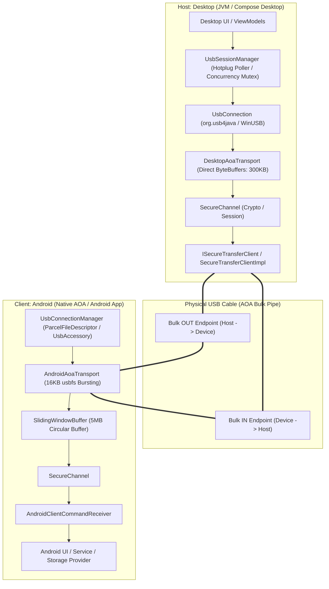
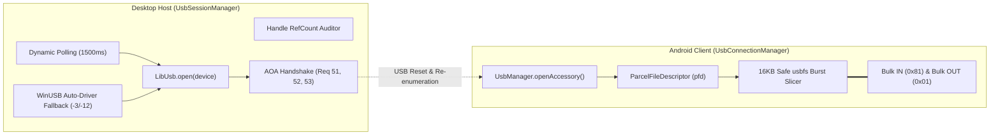
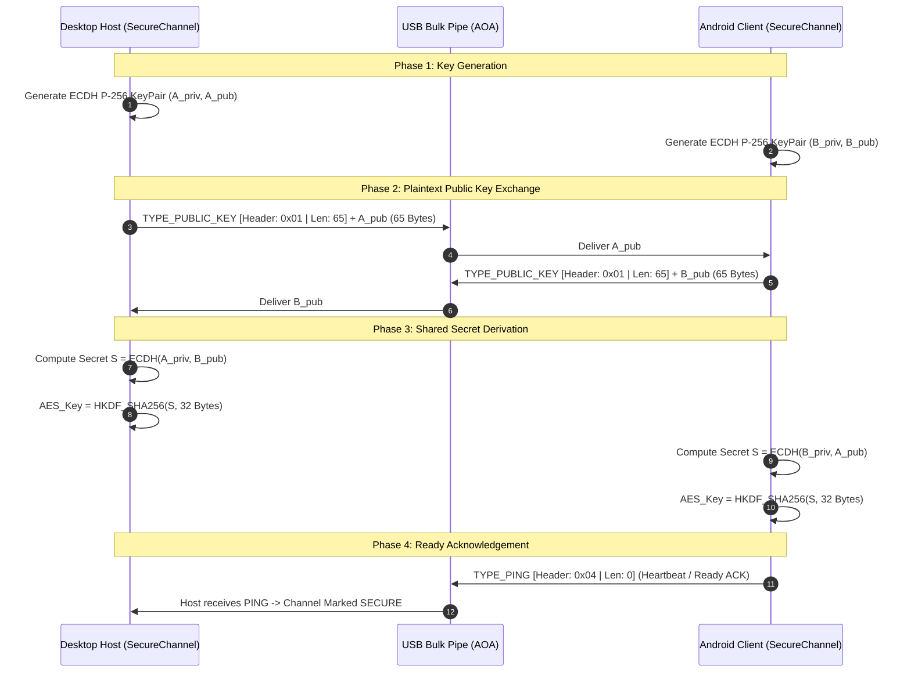

# SecureQT SDK & USB Transfer Protocol Specification

An in-depth technical specification and architectural manual for [`com.example.secureqt.sdk.SecureQtSdk`](file:///D:/Shreyas/Projects/KMP/SecureQuickTransfer/secureqt-sdk/src/commonMain/kotlin/com/example/secureqt/sdk/SecureQtSdk.kt), Android and Desktop USB Communication Managers, wire protocol codecs, sliding window buffering, and end-to-end transfer pipelines.

---

## 1. Executive Architecture Overview

The SecureQT SDK provides a unified, cross-platform (Kotlin Multiplatform) communication layer for high-throughput, encrypted data transfer over physical USB connections using the **Android Open Accessory (AOA)** protocol.



### 1.1 Core Multiplatform Facade: `SecureQtSdk`
Located in [`com.example.secureqt.sdk.SecureQtSdk`](file:///D:/Shreyas/Projects/KMP/SecureQuickTransfer/secureqt-sdk/src/commonMain/kotlin/com/example/secureqt/sdk/SecureQtSdk.kt), this singleton object serves as the single source of truth and factory for creating protocol components:

```kotlin
object SecureQtSdk {
    const val VERSION = "1.0.0"
    
    fun createSession() = SecureSession()
    fun createBuffer() = SlidingWindowBuffer()
    fun createChannel(transport: IUsbTransport): SecureChannel = SecureChannel(transport)
    fun createTransferClient(channel: SecureChannel): ISecureTransferClient = SecureTransferClientImpl(channel)
    
    val CommandPayloadParser = com.example.secureqt.sdk.protocol.CommandPayloadParser
    val CommandPayloadBuilder = com.example.secureqt.sdk.protocol.CommandPayloadBuilder
    val StandardCommands = StandardCommandIds
    val Packets = PacketTypes
    val Codec = PacketCodec
    val Utils = FormatUtils
}
```

---

## 2. Complete End-to-End Packet Structure Specification

The SecureQT protocol uses a layered envelope architecture. Every frame transmitted across the physical USB wire adheres to strict binary schemas.

### 2.1 The Wire Envelope (PacketCodec Framing)
Every packet on the USB bus begins with a strict 5-byte header, followed by $N$ bytes of payload.

```
 0                   1                   2                   3
 0 1 2 3 4 5 6 7 8 9 0 1 2 3 4 5 6 7 8 9 0 1 2 3 4 5 6 7 8 9 0 1
+-+-+-+-+-+-+-+-+-+-+-+-+-+-+-+-+-+-+-+-+-+-+-+-+-+-+-+-+-+-+-+-+
|  Type (1 Byte)|        Payload Length N (4 Bytes, Big-Endian) 
+-+-+-+-+-+-+-+-+-+-+-+-+-+-+-+-+-+-+-+-+-+-+-+-+-+-+-+-+-+-+-+-+
|                      Payload (N Bytes)                        |
|                             ...                               |
+-+-+-+-+-+-+-+-+-+-+-+-+-+-+-+-+-+-+-+-+-+-+-+-+-+-+-+-+-+-+-+-+
```

| Field | Offset | Length | Type | Description |
|:---|:---:|:---:|:---:|:---|
| **Packet Type** | `0` | 1 Byte | `uint8` | Identifies packet purpose (`PacketTypes` constant). |
| **Payload Length** | `1` | 4 Bytes | `uint32` (BE) | Number of payload bytes following this header ($N$). |
| **Payload** | `5` | $N$ Bytes | `byte[]` | The body data (raw public key, encrypted stream, or empty). |

---

### 2.2 Wire Packet Schemas (`PacketTypes`)

#### A. Key Exchange Packet (`TYPE_PUBLIC_KEY = 0x01`)
Transmitted during handshake phase in plaintext. Contains the uncompressed 65-byte Elliptic Curve P-256 public key.

```
 0                   1                   2                   3
 0 1 2 3 4 5 6 7 8 9 0 1 2 3 4 5 6 7 8 9 0 1 2 3 4 5 6 7 8 9 0 1
+-+-+-+-+-+-+-+-+-+-+-+-+-+-+-+-+-+-+-+-+-+-+-+-+-+-+-+-+-+-+-+-+
|  Type (0x01)  |              Length = 65 (0x00000041)         |
+-+-+-+-+-+-+-+-+-+-+-+-+-+-+-+-+-+-+-+-+-+-+-+-+-+-+-+-+-+-+-+-+
| SEC1 (0x04)   |                                               |
+-+-+-+-+-+-+-+-+             EC Point X-Coordinate             |
|                            (32 Bytes)                         |
+-+-+-+-+-+-+-+-+-+-+-+-+-+-+-+-+-+-+-+-+-+-+-+-+-+-+-+-+-+-+-+-+
|                                                               |
|                     EC Point Y-Coordinate                     |
|                            (32 Bytes)                         |
+-+-+-+-+-+-+-+-+-+-+-+-+-+-+-+-+-+-+-+-+-+-+-+-+-+-+-+-+-+-+-+-+
```
- **Total Packet Size**: 70 Bytes (`5 Bytes Header` + `65 Bytes SEC1 Uncompressed Public Key`).
- **Cryptographic Purpose**: Mutual ECDH key derivation yielding symmetric AES-256-GCM root key.

#### B. Encrypted Stream Packet (`TYPE_DATA = 0x02`)
Carries all encrypted application commands, directory queries, and file chunks.

```
 0                   1                   2                   3
 0 1 2 3 4 5 6 7 8 9 0 1 2 3 4 5 6 7 8 9 0 1 2 3 4 5 6 7 8 9 0 1
+-+-+-+-+-+-+-+-+-+-+-+-+-+-+-+-+-+-+-+-+-+-+-+-+-+-+-+-+-+-+-+-+
|  Type (0x02)  |         Payload Length N = 12 + C + 16        |
+-+-+-+-+-+-+-+-+-+-+-+-+-+-+-+-+-+-+-+-+-+-+-+-+-+-+-+-+-+-+-+-+
|                     Initialization Vector (IV)                |
|                    (12 Bytes, Random Nonce)                   |
|                                                               |
+-+-+-+-+-+-+-+-+-+-+-+-+-+-+-+-+-+-+-+-+-+-+-+-+-+-+-+-+-+-+-+-+
|                                                               |
|                  AES-GCM Ciphertext (C Bytes)                 |
|                             ...                               |
+-+-+-+-+-+-+-+-+-+-+-+-+-+-+-+-+-+-+-+-+-+-+-+-+-+-+-+-+-+-+-+-+
|                                                               |
|                   AES-GCM Auth Tag (16 Bytes)                 |
+-+-+-+-+-+-+-+-+-+-+-+-+-+-+-+-+-+-+-+-+-+-+-+-+-+-+-+-+-+-+-+-+
```
- **Total Overhead**: 33 Bytes (`5B Framing Header` + `12B IV` + `16B Auth Tag`).
- **Maximum 256KB Chunk Frame Size**: $5 + 12 + 262,144 + 16 = 262,177\text{ Bytes}$.

#### C. Stream Terminator Packet (`TYPE_EOF = 0x03`)
Signals the end of an active file, directory ZIP, or multi-packet response stream.
```
 0                   1                   2                   3
 0 1 2 3 4 5 6 7 8 9 0 1 2 3 4 5 6 7 8 9 0 1 2 3 4 5 6 7 8 9 0 1
+-+-+-+-+-+-+-+-+-+-+-+-+-+-+-+-+-+-+-+-+-+-+-+-+-+-+-+-+-+-+-+-+
|  Type (0x03)  |              Length = 0 (0x00000000)          |
+-+-+-+-+-+-+-+-+-+-+-+-+-+-+-+-+-+-+-+-+-+-+-+-+-+-+-+-+-+-+-+-+
```
- **Total Packet Size**: 5 Bytes (`Payload = 0 Bytes`).

#### D. Sync / Heartbeat Packet (`TYPE_PING = 0x04`)
Dispatched during connection synchronization to confirm client readiness.
```
 0                   1                   2                   3
 0 1 2 3 4 5 6 7 8 9 0 1 2 3 4 5 6 7 8 9 0 1 2 3 4 5 6 7 8 9 0 1
+-+-+-+-+-+-+-+-+-+-+-+-+-+-+-+-+-+-+-+-+-+-+-+-+-+-+-+-+-+-+-+-+
|  Type (0x04)  |              Length = 0 (0x00000000)          |
+-+-+-+-+-+-+-+-+-+-+-+-+-+-+-+-+-+-+-+-+-+-+-+-+-+-+-+-+-+-+-+-+
```
- **Total Packet Size**: 5 Bytes.

#### E. Transport Error Packet (`TYPE_ERROR = 0x05`)
Informs peer of fatal protocol or I/O failure.
```
 0                   1                   2                   3
 0 1 2 3 4 5 6 7 8 9 0 1 2 3 4 5 6 7 8 9 0 1 2 3 4 5 6 7 8 9 0 1
+-+-+-+-+-+-+-+-+-+-+-+-+-+-+-+-+-+-+-+-+-+-+-+-+-+-+-+-+-+-+-+-+
|  Type (0x05)  |              Error String Length N            |
+-+-+-+-+-+-+-+-+-+-+-+-+-+-+-+-+-+-+-+-+-+-+-+-+-+-+-+-+-+-+-+-+
|                   UTF-8 Error Message (N Bytes)               |
+-+-+-+-+-+-+-+-+-+-+-+-+-+-+-+-+-+-+-+-+-+-+-+-+-+-+-+-+-+-+-+-+
```

#### F. Cancellation Packet (`TYPE_CANCEL = 0x06`)
Emergency out-of-band abort signal dispatched upon user request.
```
 0                   1                   2                   3
 0 1 2 3 4 5 6 7 8 9 0 1 2 3 4 5 6 7 8 9 0 1 2 3 4 5 6 7 8 9 0 1
+-+-+-+-+-+-+-+-+-+-+-+-+-+-+-+-+-+-+-+-+-+-+-+-+-+-+-+-+-+-+-+-+
|  Type (0x06)  |              Length = 0 (0x00000000)          |
+-+-+-+-+-+-+-+-+-+-+-+-+-+-+-+-+-+-+-+-+-+-+-+-+-+-+-+-+-+-+-+-+
```
- **Total Packet Size**: 5 Bytes.

---

### 2.3 Application Command Payload Schemas (`StandardCommandIds` / `AppCommandIds`)

All application command payloads are encrypted inside `TYPE_DATA` packets. Once decrypted, their inner structures are defined as follows:

#### 1. `CMD_LIST_DIR` (`0x00`)
- **Request Format (Desktop &rarr; Android):**
```
+-+-+-+-+-+-+-+-+-+-+-+-+-+-+-+-+-+-+-+-+-+-+-+-+-+-+-+-+-+-+-+-+
| Cmd = 0x00 (1B) | Path Length P (4B, BE) | UTF-8 Path (P Bytes)|
+-+-+-+-+-+-+-+-+-+-+-+-+-+-+-+-+-+-+-+-+-+-+-+-+-+-+-+-+-+-+-+-+
```
- **Response Format (Android &rarr; Desktop):**
  1. Header Packet: `[4 Bytes Count M]`
  2. Followed by $M$ separate packets for each directory entry:
```
+-+-+-+-+-+-+-+-+-+-+-+-+-+-+-+-+-+-+-+-+-+-+-+-+-+-+-+-+-+-+-+-+
| isDir (1B) | File Size (8B Long, BE) | Name Len L (4B)| Name (L B) |
+-+-+-+-+-+-+-+-+-+-+-+-+-+-+-+-+-+-+-+-+-+-+-+-+-+-+-+-+-+-+-+-+
```

#### 2. `CMD_SEND_FILE_START` (`0x01`)
- **Transfer Header (Desktop &rarr; Android):**
```
+-+-+-+-+-+-+-+-+-+-+-+-+-+-+-+-+-+-+-+-+-+-+-+-+-+-+-+-+-+-+-+-+
| Cmd = 0x01 (1B) | Path Len P (4B) | UTF-8 Path (P B) | File Size (8B) |
+-+-+-+-+-+-+-+-+-+-+-+-+-+-+-+-+-+-+-+-+-+-+-+-+-+-+-+-+-+-+-+-+
```
- Followed by continuous 256KB chunks in `TYPE_DATA`, terminated by `TYPE_EOF`.

#### 3. `CMD_FETCH_FILE_START` (`0x02`)
- **Request (Desktop &rarr; Android):**
```
+-+-+-+-+-+-+-+-+-+-+-+-+-+-+-+-+-+-+-+-+-+-+-+-+-+-+-+-+-+-+-+-+
| Cmd = 0x02 (1B) | Path Len P (4B) | UTF-8 Path (P Bytes)       |
+-+-+-+-+-+-+-+-+-+-+-+-+-+-+-+-+-+-+-+-+-+-+-+-+-+-+-+-+-+-+-+-+
```
- **Response File Info (Android &rarr; Desktop):** `[8 Bytes File Size (Long, BE)]`.
- Followed by continuous 256KB file chunks in `TYPE_DATA`, terminated by `TYPE_EOF`.

#### 4. `CMD_FETCH_DIR_ZIP_START` (`0x03`)
- **Request (Desktop &rarr; Android):** `[0x03 (1B)][4B PathLen][UTF-8 Path]`.
- **Response File Info:** `[8 Bytes TotalSize (0L if streaming on-the-fly)]`.
- Followed by dynamic ZIP chunks in `TYPE_DATA`, terminated by `TYPE_EOF`.

#### 5. `CMD_DISCONNECT` (`0x04`)
- **Payload:** `[0x04 (1 Byte)]`. Instructs peer to flush buffers and release native handles.

#### 6. `CMD_SEND_DIR_ZIP_START` (`0x05`)
- **Header:** `[0x05 (1B)][4B PathLen][UTF-8 Path][8B 0L (Dynamic Size)]`.
- Followed by streamed ZIP chunks in `TYPE_DATA`, terminated by `TYPE_EOF`.

#### 7. `CMD_DELETE_FILE` (`0x06`)
- **Request:** `[0x06 (1B)][4B PathLen][UTF-8 Path]`.
- **Response:** `[1 Byte Success Flag: 0x01 = Success, 0x00 = Fail]`.

#### 8. `CMD_RENAME_FILE` (`0x07`)
- **Request:** `[0x07 (1B)][4B PathLen][UTF-8 OldPath][4B NameLen][UTF-8 NewName]`.
- **Response:** `[1 Byte Success Flag: 0x01 = Success, 0x00 = Fail]`.

#### 9. `CMD_CREATE_FOLDER` (`0x08`)
- **Request:** `[0x08 (1B)][4B PathLen][UTF-8 Path]`.
- **Response:** `[1 Byte Success Flag: 0x01 = Success, 0x00 = Fail]`.

#### 10. `CMD_SET_DEVICE_ID` (`0x09`)
- **Request:** `[0x09 (1B)][4B IdLen][UTF-8 DeviceId]`. Registers peer hardware identifier.

#### 11. `CMD_CANCEL_TRANSFER` (`0x0F`)
- **Payload:** `[0x0F (1 Byte)]`. Application-level transfer cancellation notice.

---

## 3. High-Throughput Sliding Window Buffer Architecture

In streaming USB bulk endpoints, native read calls return fragmented or coalesced bytes depending on bus latency, host controller buffering, and kernel scheduling. The [`SlidingWindowBuffer`](file:///D:/Shreyas/Projects/KMP/SecureQuickTransfer/secureqt-sdk/src/commonMain/kotlin/com/example/secureqt/sdk/buffer/SlidingWindowBuffer.kt) (default `5 MB`) solves the stream framing problem with **zero GC thrashing**.

### 3.1 Pointer-Based Circular Buffer Dynamics
Instead of allocating and discarding `ByteArray` slices on every packet, `SlidingWindowBuffer` maintains two indices over an internal continuous buffer:
- `head`: Points to the start of unprocessed stream data.
- `tail`: Points to the write cursor where new raw incoming USB bytes are appended.
- `size = tail - head`: Represents unread available bytes.

```
Initial / Steady State:
+-------------------+------------------------------------+-------------------+
|  Consumed Region  |       Available Stream Data        |    Free Space     |
|   (Unused Bytes)  |       [size = tail - head]         |                   |
+-------------------+------------------------------------+-------------------+
0                 head                                  tail              capacity (5MB)

Compaction Action (Triggered on Demand when tail reaches limit):
                     head                            tail
                      |                               |
                      v                               v
[ ...stale... ] ---> [ Byte0, Byte1, ... ByteN-1 ]
                      |
                      | System.arraycopy(buffer, head, buffer, 0, len)
                      v
+------------------------------------+---------------------------------------+
|       Compacted Stream Data        |          Restored Free Space          |
+------------------------------------+---------------------------------------+
0 (head)                           tail                                   capacity (5MB)
```

### 3.2 Sliding Window Ingestion Algorithm
1. **Packet Header Extraction:**
   - Loop `transport.read()` until `rxBuffer.has(5)` is `true`.
   - `rxBuffer.take(5)` extracts the header; `head` increments by 5.
   - Codec extracts `type` (`header[0]`) and `payloadLength` (`header[1..4]`).
2. **Payload Extraction:**
   - Loop `transport.read()` until `rxBuffer.has(payloadLength)` is `true`.
   - `rxBuffer.take(payloadLength)` extracts the exact slice; `head` increments by `payloadLength`.
3. **In-Place Compaction:**
   - When incoming bytes exceed remaining space to `capacity`, `compact()` slides remaining `[head..tail]` bytes to position `0`.
   - Buffer memory is reused perpetually, preventing Android DVM / JVM Garbage Collector pause spikes during 100+ MB/s transfers.

---

## 4. Hardware USB Communication Managers

The protocol connects two completely distinct USB operating system subsystems: Host Desktop (`usb4java` / `libusb`) and Client Android (`UsbManager` / AOA).



### 4.1 Host Desktop: `UsbSessionManager` & `UsbConnection`
Implemented in [`UsbSessionManager.kt`](file:///D:/Shreyas/Projects/KMP/SecureQuickTransfer/composeApp/src/jvmMain/kotlin/com/example/securequicktransferapp/data/usb/UsbSessionManager.kt) and [`UsbConnection.kt`](file:///D:/Shreyas/Projects/KMP/SecureQuickTransfer/composeApp/src/jvmMain/kotlin/com/example/securequicktransferapp/data/usb/UsbConnection.kt):

1. **Native Handle Management & Leak Prevention:**
   - During polling (every `1500ms`), `deviceManager.discoverDevices()` increments native `libusb_device` reference counts.
   - For already active sessions, `UsbSessionManager` calls `deviceManager.releaseDevice(device)` immediately to avoid leaking native C heap handles.
2. **AOA Switching Protocol:**
   - Sends standard USB control transfers to Device Endpoint 0:
     - `Req 51` (`GET_PROTOCOL`): Ensures device supports AOA 1.0 or 2.0.
     - `Req 52` (`SEND_STRING`): Transmits Manufacturer ("AndroidOpenAccessory") and Model ("DataTransfer").
     - `Req 53` (`START_ACCESSORY`): Commands Android to reboot the USB controller into accessory VID/PID (`0x2D00` / `0x2D01`).
3. **Windows WinUSB PnP Driver Retries:**
   - On Windows, re-enumerated AOA devices trigger driver rebinding that produces transient `LibUsb.ERROR_ACCESS (-3)` or `LibUsb.ERROR_NOT_SUPPORTED (-12)`.
   - `UsbConnection.open()` implements an exponential retry loop (up to 16 attempts with 500ms sleep) to allow the OS to complete WinUSB binding before failing.
4. **Desktop Transport Buffers:**
   - Uses `DesktopAoaTransport` with direct off-heap `ByteBuffer.allocateDirect(300 * 1024)` to achieve zero-copy transfers from native C buffers into JVM memory.

### 4.2 Client Android: `UsbConnectionManager` & `AndroidAoaTransport`
Implemented in [`UsbConnectionManager.kt`](file:///D:/Shreyas/Projects/KMP/SecureQuickTransfer/composeApp/src/androidMain/kotlin/com/example/securequicktransferapp/data/usb/connection/UsbConnectionManager.kt) and [`AndroidAoaTransport.kt`](file:///D:/Shreyas/Projects/KMP/SecureQuickTransfer/secureqt-sdk/src/androidMain/kotlin/com/example/secureqt/sdk/transport/android/AndroidAoaTransport.kt):

1. **Dual Connection Modes:**
   - **Accessory Mode:** Android acts as USB device attached to PC host; accesses communication through `UsbAccessory` and `ParcelFileDescriptor` (`FileInputStream`/`FileOutputStream`).
   - **Host Mode:** Android acts as USB host (OTG); accesses communication via `UsbDeviceConnection` and bulk `UsbEndpoint`.
2. **The 16KB Linux `usbfs` Kernel Slicing Limit:**
   - The Linux kernel driver for Android USB (`usbfs`) has a hard burst transfer ceiling (`MAX_USBFS_BURST_SIZE = 16384 bytes`).
   - Writing more than 16KB in a single native `bulkTransfer` or file write often results in silent byte truncation or `EOVERFLOW`.
   - `AndroidAoaTransport` transparently slices 256KB logical blocks into sequential 16KB bursts:
   ```kotlin
   val chunk = minOf(MAX_USBFS_BURST_SIZE, remaining)
   val written = pfdOutputStream.write(buffer, offset, chunk)
   ```

---

## 5. End-to-End Cryptographic Handshake

The cryptographic handshake guarantees mutual end-to-end encryption without passing passwords over the wire.



---

## 6. End-to-End File Transfer Protocol

File transmission utilizes an asynchronous, 3-stage coroutine pipeline that overlaps disk I/O, encryption, and physical USB writing.

### 6.1 Multi-Stage Pipeline Architecture (Producer-Consumer)
```
[ Disk Read Job (IO) ]  -- Channel<ByteArray>(32) --> [ AES-GCM Encrypt (Default) ]
                                                                |
                                                      Channel<ByteArray>(32)
                                                                v
[ Physical USB Bulk Pipe ] <-- sendPrebuiltPacket() <-- [ USB Write Loop (IO) ]
```

### 6.2 File Transfer Sequence Diagram (Desktop Sending File to Android)

```mermaid
sequenceDiagram
    autonumber
    participant D_IO as Desktop File Reader
    participant D_Enc as Desktop AES-GCM Engine
    participant D_USB as Desktop USB Transport
    participant Pipe as USB Wire (Bulk OUT)
    participant A_USB as Android USB Transport
    participant A_Dec as Android AES-GCM Engine
    participant A_Disk as Android Storage Sink

    Note over D_IO,A_Disk: Step 1: Send File Metadata Header
    D_Enc->>D_USB: Encrypt [CMD_SEND_FILE_START | PathLen | Path | TotalSize 8B]
    D_USB->>Pipe: TYPE_DATA [5B Header + 12B IV + Ciphertext]
    Pipe->>A_USB: Ingest via SlidingWindowBuffer
    A_USB->>A_Dec: Decrypt Payload
    A_Dec->>A_Disk: Parse Path & Size; open FileOutputStream(target)

    Note over D_IO,A_Disk: Step 2: Continuous 256KB Chunk Streaming
    loop Until All Chunks Transmitted
        D_IO->>D_Enc: Read 256KB unencrypted file chunk
        D_Enc->>D_Enc: Generate random 12B IV + compute AES-GCM tag
        D_Enc->>D_USB: Prebuilt Packet [TYPE_DATA | Len: 262,173B | IV: 12B | Ciphertext: 256KB + 16B Tag]
        D_USB->>Pipe: Write to Bulk OUT Endpoint
        Pipe->>A_USB: Bulk Read into SlidingWindowBuffer
        A_USB->>A_Dec: Extract & Decrypt 256KB block
        A_Dec->>A_Disk: fos.write(decryptedChunk)
    end

    Note over D_IO,A_Disk: Step 3: Stream Finalization
    D_USB->>Pipe: TYPE_EOF [Header: 0x03 | Len: 0]
    Pipe->>A_USB: Ingest TYPE_EOF
    A_USB->>A_Disk: Flush buffer & close FileOutputStream
```

---

## 7. Line Diagram & Wire Packet Anatomy

Here is the exact byte-level breakdown of an encrypted 256KB file transfer chunk on the USB wire:

```
BYTE OFFSET
00000000:  [ 0x02 ]                           --> Packet Type: TYPE_DATA (1 byte)
00000001:  [ 0x00, 0x04, 0x00, 0x1C ]         --> Payload Length: 262,172 bytes (4 bytes big-endian)
           ---------------------------------- [ End of 5-Byte PacketCodec Header ]
00000005:  [ 12 Bytes Random IV ]             --> AES-GCM Nonce / Initialization Vector
           ----------------------------------
00000017:  [ Encrypted 262,144 Bytes ]       --> AES-GCM Ciphertext (256 KB file chunk)
           ...                                ...
00040017:  [ 16 Bytes GCM Auth Tag ]          --> Poly1305 / GHASH Authentication Tag
           ---------------------------------- [ Total On-Wire Frame Size: 262,177 Bytes ]
```

### Complete Transmission Line Diagram
```
Time (t)   Host Desktop (Sender)                         Client Android (Receiver)
   |
t0 |  [Read File Chunk 0..256KB]
   |  [Generate 12B IV]
   |  [AES-GCM Encrypt -> Tag]
   |  [Single Alloc: 5B + 12B + 256KB + 16B]
t1 |  ====== TYPE_DATA Packet (262,177 Bytes) ======>
   |                                                [SlidingWindowBuffer.append()]
   |                                                [SlidingWindowBuffer.take(5) -> Header]
   |                                                [SlidingWindowBuffer.take(N) -> Payload]
   |                                                [AES-GCM Decrypt & Verify Tag]
t2 |                                                [Write 256KB to Disk Sink]
   |
t3 |  ====== TYPE_DATA Packet (262,177 Bytes) ======>
   |                                                [Process Chunk 1...]
   |  ...                                           ...
tn |  ====== TYPE_EOF Packet (5 Bytes: 0x03) =======>
   |                                                [EOF Detected -> File Sink Closed]
   v
```

---

## 8. Directory & Dynamic ZIP Transfer Protocol

When transferring full directory hierarchies, generating intermediate `.zip` files on disk creates massive storage overhead and latency. SecureQT SDK implements a **Zero-Disk-Space On-The-Fly Streaming ZIP Pipeline** using inter-thread memory pipes:

```mermaid
flowchart LR
    subgraph Sender["Sender Directory Pipeline"]
        Walk["Local Directory WalkTopDown()"]
        ZOS["ZipOutputStream"]
        P_OUT["PipedOutputStream"]
        P_IN["PipedInputStream"]
        Chunker["256KB Chunk Reader"]
        Enc["AES-GCM Encrypt"]
    end

    subgraph Receiver["Receiver Directory Pipeline"]
        Dec["AES-GCM Decrypt"]
        RP_OUT["PipedOutputStream"]
        RP_IN["PipedInputStream"]
        ZIS["ZipInputStream"]
        Extractor["Extract Entries to Target Folder"]
    end

    Walk --> ZOS
    ZOS --> P_OUT
    P_OUT ===|In-Memory Pipe| P_IN
    P_IN --> Chunker
    Chunker --> Enc
    Enc ===|USB Pipe (TYPE_DATA)| Dec
    Dec --> RP_OUT
    RP_OUT ===|In-Memory Pipe| RP_IN
    RP_IN --> ZIS
    ZIS --> Extractor
```

---

## 9. Text & Metadata Transfer Protocol

All control instructions, folder navigations, renames, and queries are transmitted as structured text commands inside `TYPE_DATA` encrypted frames:

### 9.1 Pipe Diagram: `CMD_LIST_DIR`
```
[ Host: Request Directory Listing ]
    |
    |-- Payload: [0x00][4B PathLen][Path UTF-8 String]
    v
[ Encrypt & Wrap: TYPE_DATA ] === USB BULK OUT ===> [ Android: Receive & Decrypt ]
                                                           |
                                                           |-- Resolves Path with SmartNavStorageResolver
                                                           |-- Enumerate File Entries (Total = M)
                                                           v
[ Host: Parse Remote Files ] <=== USB BULK IN <=== [ Android: Send Response Sequence ]
    ^                                                      |
    |-- Read Count: 4-Byte Int (M) -----------------------|-- Packet 1: [4B Int: M]
    |-- Loop i in 1..M:                                   |-- For Each Item:
    |   Read: [1B isDir][8B Size][4B NameLen][UTF-8 Name] -|-- Packet (i+1): [1B isDir][8B Size][4B NameLen][UTF-8 Name]
```

### 9.2 Pipe Diagram: Device Identification (`CMD_SET_DEVICE_ID`)
```
[ Desktop Host ]                                   [ Android Client ]
      |                                                    |
      |-- idBytes = "desktop_host_01".toByteArray()        |
      |-- buffer = [0x09][4B idLength][idBytes]            |
      |-- sendSecure(buffer)                               |
      v                                                    v
[ AES-GCM Encrypt ] === TYPE_DATA (USB Wire) ===> [ AndroidClientCommandReceiver ]
                                                           |-- Read 0x09 Command
                                                           |-- Parse UTF-8 Host String
                                                           |-- Broadcast to ViewModel
```

---

## 10. Concurrency, Mutex Isolation & Cancellation

1. **Per-Device Concurrency Mutex:**
   - Both `SecureTransferClientImpl` and `UsbSession` guard all operations with a Kotlin Coroutine `Mutex` (`commandMutex` / `sessionMutex`).
   - Prevents interleaving of `CMD_LIST_DIR` requests while a 4GB file transfer is actively utilizing the bulk pipe.
2. **Atomic Cancellation Flow (`CMD_CANCEL_TRANSFER` / `TYPE_CANCEL`):**
   - When the user cancels in the UI, `isCancelled` is marked `true` and a high-priority `TYPE_CANCEL` (`0x06`) frame is pushed to the USB pipe.
   - The remote peer receives `TYPE_CANCEL`, aborts its read/write jobs, closes active streams, and deletes partial temporary files immediately.

---

## 11. SDK Summary Specification Table

| Layer / Feature | Specification | Implementation Reference |
|:---|:---|:---|
| **SDK Facade** | Version 1.0.0, Kotlin Multiplatform | [`SecureQtSdk.kt`](file:///D:/Shreyas/Projects/KMP/SecureQuickTransfer/secureqt-sdk/src/commonMain/kotlin/com/example/secureqt/sdk/SecureQtSdk.kt) |
| **Physical Transport**| Android Open Accessory (AOA) Bulk IN/OUT | [`AndroidAoaTransport.kt`](file:///D:/Shreyas/Projects/KMP/SecureQuickTransfer/secureqt-sdk/src/androidMain/kotlin/com/example/secureqt/sdk/transport/android/AndroidAoaTransport.kt) / [`DesktopAoaTransport.kt`](file:///D:/Shreyas/Projects/KMP/SecureQuickTransfer/secureqt-sdk/src/jvmMain/kotlin/com/example/secureqt/sdk/transport/desktop/DesktopAoaTransport.kt) |
| **Android usbfs Burst**| 16,384 Bytes (`16 KB`) safe slice | `AndroidAoaTransport.MAX_USBFS_BURST_SIZE` |
| **Desktop Direct Buf**| 307,200 Bytes (`300 KB`) direct NIO | `DesktopAoaTransport.readBuffer` |
| **Sliding Window** | 5,242,880 Bytes (`5 MB`) circular pointer | [`SlidingWindowBuffer.kt`](file:///D:/Shreyas/Projects/KMP/SecureQuickTransfer/secureqt-sdk/src/commonMain/kotlin/com/example/secureqt/sdk/buffer/SlidingWindowBuffer.kt) |
| **Packet Codec Header**| 5 Bytes (`1B Type + 4B Length`) | [`PacketCodec.kt`](file:///D:/Shreyas/Projects/KMP/SecureQuickTransfer/secureqt-sdk/src/commonMain/kotlin/com/example/secureqt/sdk/protocol/PacketCodec.kt) |
| **Cryptographic Engine**| ECDH P-256 + AES-256-GCM (12B IV, 16B Tag) | [`SecureSession.kt`](file:///D:/Shreyas/Projects/KMP/SecureQuickTransfer/secureqt-sdk/src/commonMain/kotlin/com/example/secureqt/sdk/crypto/SecureSession.kt) |
| **File Chunk Size** | 262,144 Bytes (`256 KB`) logical blocks | `SecureTransferClientImpl.CHUNK_SIZE` |
| **Directory Streaming**| Zero-disk Piped Zip In/Out Streams | `SecureTransferClientImpl.sendDirectory` / `fetchRemoteDirectory` |
